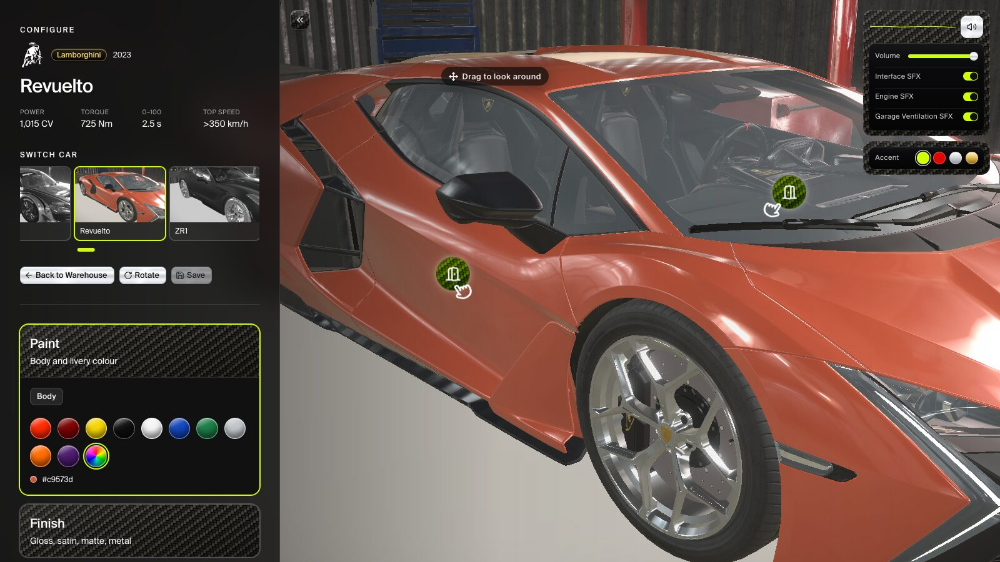
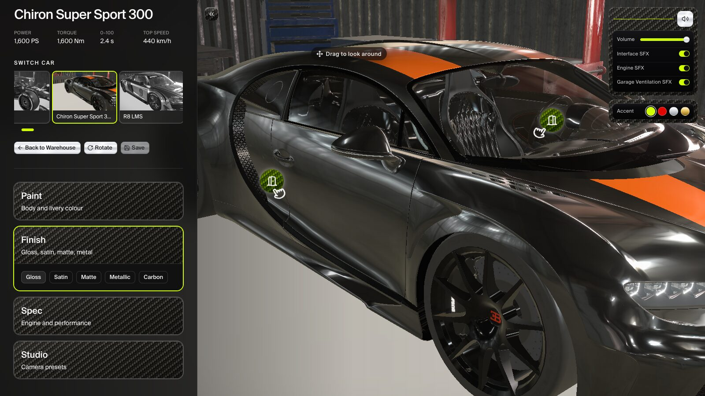
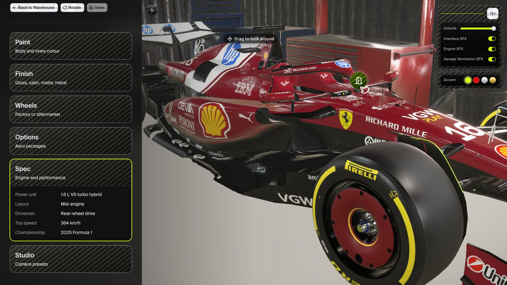
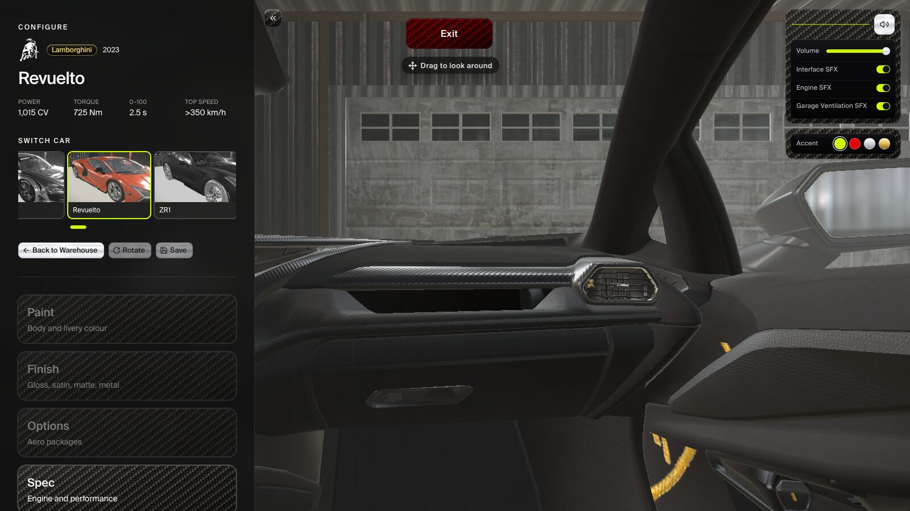

# Supercar threejs astro configurator

<a href="https://astro.build"></a>
&nbsp;
<a href="https://react.dev"></a>
&nbsp;
<a href="https://www.typescriptlang.org"></a>
&nbsp;
<a href="https://threejs.org"></a>
&nbsp;
<a href="https://tailwindcss.com"></a>
&nbsp;
<a href="https://vite.dev"></a>
&nbsp;
<a href="https://www.radix-ui.com"></a>

A 3D garage in the browser. Walk a warehouse of twelve supercars, pick one, and configure its paint, finish, wheels and aero, then open the door, sit in the cabin and start the engine.

**[▶ Live demo](https://supercar-threejs-astro-configurator.vercel.app/)** · desktop only


| | |
| --- | --- |
|  |  |
| **Paint** – swatches or a custom colour per paint group | **Finish** – gloss, satin, matte, metallic and carbon |
|  |  |
| **Spec** – engine and performance for every car | **Cabin** – open a door and sit in the seat |

## Tech

<a href="https://astro.build"></a>
&nbsp;
<a href="https://react.dev"></a>
&nbsp;
<a href="https://www.typescriptlang.org"></a>
&nbsp;
<a href="https://threejs.org"></a>
&nbsp;
<a href="https://tailwindcss.com"></a>
&nbsp;
<a href="https://vite.dev"></a>
&nbsp;
<a href="https://www.radix-ui.com"></a>

- **Astro 5** for the site shell, static routes and SEO
- **React 19** with **React Three Fiber**, **Drei** and **postprocessing** for the 3D scenes
- **Three.js** for GLB models, materials and lighting
- **Zustand** for the current build and saved garage
- **Tailwind CSS v4**, **Radix UI** and **shadcn/ui** for the panels
- **TypeScript** throughout, deployed on **Vercel**

## Features

- **Warehouse** – browse twelve cars, from a Ferrari Enzo and Bugatti Chiron to the Ferrari SF-25 and Red Bull RB18 F1 cars
- **Paint by part** – each car exposes its own paint groups (body, engine cover, livery) mapped to the model's materials
- **Finishes** – gloss, satin, matte, metallic and carbon
- **Wheels** – factory or aftermarket rims, with a choice of rim colour
- **Aero options** – toggle a car's aero parts on and off
- **Camera presets** – front, 3/4, side, rear and detail, plus an interior view from the cabin
- **Doors and cabin** – click a door hotspot to open it and move into the driver's seat
- **Ignition** – press START in the cabin to hear the engine
- **Sound design** – garage ambience, spray paint, impact drill, door and UI sounds, with a sound panel to control them
- **Saved builds** – save a configuration with a thumbnail and reopen it later from your garage (stored in `localStorage`)
- **Spec and history** – performance figures and a short history for every car

## Why both Astro and React

Astro owns the site shell: the HTML document, the two routes, and the model preloads. Each configure URL is a static page generated from the car list.

React owns everything that has to stay live: the canvas, paint, camera, doors, and sound. Those pieces are mounted with `client:only="react"` because a WebGL scene cannot be rendered as static HTML.

Zustand sits between the panels and the scene, so the configurator UI and the 3D car read and write the same build.

## Cars are data

Every car is a single typed definition in `src/cars/`. The schema maps the model's materials to paint groups, locks the materials that should not change, and declares doors, cabin seats, aero parts and specs. Adding a car is a new file plus a GLB in `public/models/` uploaded to [Vercel Blob](#models-on-vercel-blob), with no component changes:

```ts
export const ferrariEnzo = defineCar({
  slug: "ferrari-enzo",
  brand: "ferrari",
  name: "Enzo",
  year: "2002",
  model: FERRARI_ENZO_MODEL,
  targetLength: 4.7,
  defaultFinish: "satin",
  defaultPaints: { body: "#0D0D0D", engine: "#0D0D0D" },
  paintGroups: [
    { id: "body", label: "Body", material: "Pintura" },
    { id: "engine", label: "Engine cover", material: "tapa motor" },
  ],
  // locked materials, aero parts, doors, cabin, spec, history...
});
```

## Performance and SEO

- Key models, images and sounds are preloaded in the page head, and each car's model is prefetched from the picker before you click
- GLBs are served from Vercel Blob under content-hashed names with a one-year cache, so deploys stay small and a model is never downloaded twice
- One static page per car via `getStaticPaths`, each with its own title, description and preview image
- JSON-LD structured data, a generated sitemap and `robots.txt`
- Vercel Analytics and Speed Insights

## Project structure

```
src/
  cars/          one definition per car + the car list
  components/
    warehouse/   the warehouse scene
    garage/      configurator scene, wheels, door and ignition hotspots
    car/         car model, decals
    overlay/     panels: tuner, spec, saved builds, sound, preloader
    ui/          shadcn/ui primitives
  lib/           store, schema, materials, camera paths, audio, model manifest
  pages/         index.astro, configure/[slug].astro, robots.txt
scripts/         model upload, sync and build check
public/
  models/        GLB models (gitignored, served from Blob) and textures
  sounds/        ambience and effects
  ui/            brand marks, previews
```

## Run

```bash
bun install
bun run models:sync   # first clone only: download the GLBs into public/models
bun dev
```

Open `http://127.0.0.1:4321`. The studio is desktop only.

```bash
bun run build    # static build to dist/
bun run preview  # serve the build locally
```

## Models on Vercel Blob

GLB files are not committed or deployed. They live in Vercel Blob, and `src/lib/model-manifest.json` maps each path under `public/models/` to its Blob URL. Dev serves the local files; production builds use the Blob URLs.

```bash
bun run models:upload          # upload new or changed GLBs, then commit the manifest
bun run models:upload --prune  # also delete blobs the manifest no longer uses
bun run models:sync            # download missing GLBs from Blob
bun run models:check           # verify every model resolves (runs before each build)
```

Each upload is named by a hash of its contents (`models/rim/rim.ca31db284a2f.glb`), so a changed model gets a new URL and needs no manual cache-busting. Uploading needs `BLOB_READ_WRITE_TOKEN` in `.env.local`, copied from the Blob store page in the Vercel dashboard.

To add a model, put the GLB in `public/models/<slug>/`, reference it with `modelUrl("<slug>/<slug>.glb")` in `src/lib/constants.ts`, then run `bun run models:upload`. Car GLBs must keep their node, mesh and material names, so don't run the default `gltf-transform optimize` on them.

## Engine bay

The Engine section of the configure panel moves the camera to an engine on a stand in the garage, where you can recolour it, tune it, explode it and rev it. Each car picks a V8 or a V12 with `engineModel` in `src/cars/*.ts`, and tuning works from each car's published figures (`engineBase`). The tuned numbers are illustrative.

Both engines are NVIDIA SimReady assets, licensed [CC BY 4.0](https://creativecommons.org/licenses/by/4.0/): [`engineAssembly_v8_engine_a01`](https://huggingface.co/datasets/nvidia/simready-assets/tree/main/engineAssembly_v8_engine_a01) and [`engineAssembly_v12_engine_a01`](https://huggingface.co/datasets/nvidia/simready-assets/tree/main/engineAssembly_v12_engine_a01). They're converted from USD with `scripts/build-engine-glb.py` in Blender 4.2 or later. The header of that script lists the steps.
